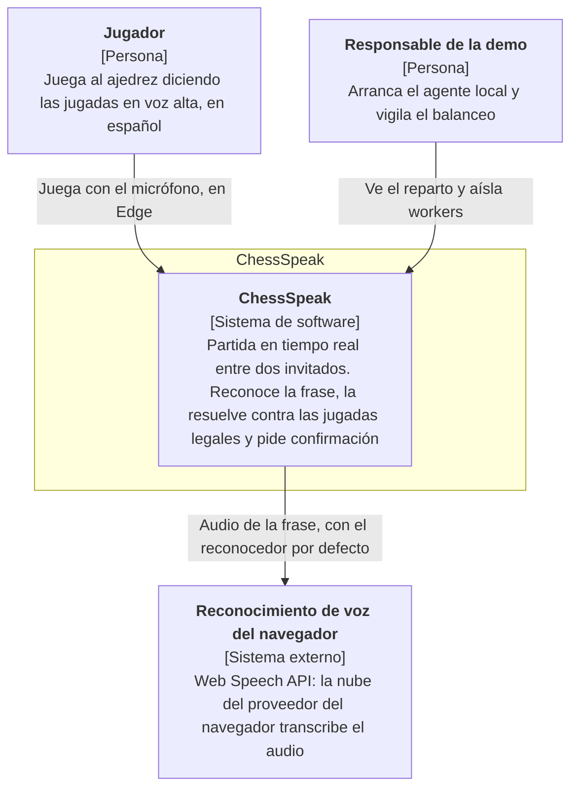
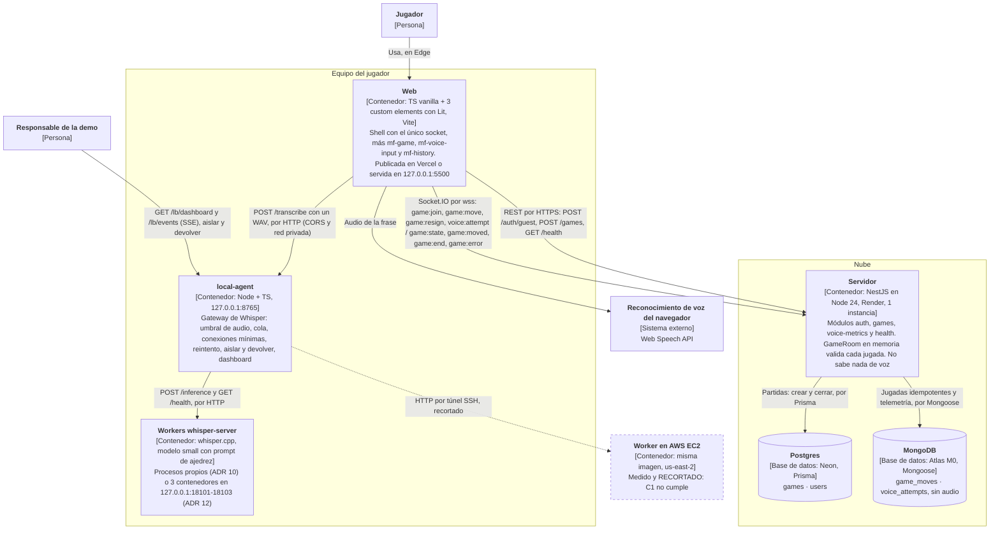

# C4: niveles 1 y 2

Diagramas C4 de ChessSpeak: **contexto (nivel 1)** y **contenedores (nivel 2)**. Describen el código de `main` a 14 de noviembre de 2026. El detalle de cada decisión está en [ARCHITECTURE.md](../ARCHITECTURE.md) y en los [ADR](adr/).

**Notación.** Se usan diagramas de flujo de Mermaid con las convenciones de C4, en vez de la sintaxis `C4Context` de Mermaid, que es experimental y GitHub la dibuja mal:

- cada caja dice su tipo entre corchetes y su tecnología;
- las flechas dicen qué se envía y por qué protocolo;
- **lo discontinuo no se usa:** se preparó y se midió, pero quedó recortado.

## Nivel 1: contexto

| Elemento | Qué es |
|---|---|
| Jugador | Entra como invitado, crea una partida o se une con un enlace, y juega por voz o escribiendo. La confirmación es obligatoria |
| Responsable de la demo | Arranca `local-agent` y, para la demo del balanceo, los contenedores de Whisper. Usa el dashboard `/lb/dashboard` |
| Reconocimiento de voz del navegador | Lo usa el reconocedor por defecto (Web Speech, `es-CO`, con 400 ms de espera tras soltar). Es la nube del navegador: Google en Chrome y Microsoft en Edge. El otro reconocedor, Whisper local, es parte de ChessSpeak y no saca el audio del equipo |

## Nivel 2: contenedores

| Contenedor | Tecnología | Responsabilidad | No hace |
|---|---|---|---|
| Web | Shell en TS vanilla y 3 microfrontends con Lit en light DOM, cada uno un proyecto Vite (`web/`) | Sesión de invitado en `sessionStorage`, el único socket (solo `<mf-game>` lo recibe), los reconocedores (Strategy), `voice-parser` contra las jugadas legales, la confirmación y el reenvío de la telemetría | Validar jugadas en el servidor; guardar audio |
| Servidor | NestJS en Node 24 (`server/`), en Render | Identidad firmada por el servidor, `POST /games`, `GameRoom` (estado síncrono en memoria), validación en UCI, fin de partida, reconexión y telemetría de voz | Nada de voz: recibe jugadas en UCI y telemetría |
| Postgres | Neon, con Prisma (`server/prisma/`) | `games`: estado, resultado, terminación y jugadores. `users` existe, pero el login está fuera del plan | — |
| MongoDB | Atlas M0, con Mongoose | `game_moves` (escritura diferida e idempotente por `plyCount`) y `voice_attempts` (un documento por intento, con el `player` que pone el servidor) | Guardar audio |
| local-agent | Node + TS (`local-agent/`), en `127.0.0.1:8765` | Gateway de Whisper: umbral de volumen y duración, cola, 503/504, conexiones mínimas, un reintento en otro worker, aislar y devolver, monitor y dashboard | Reglas de ajedrez |
| Workers whisper-server | whisper.cpp `d1be6fd`, modelo `small` con el prompt de ajedrez | Transcribir un clip. Son procesos propios del agente (ADR 10) o, con `WHISPER_URLS`, contenedores de la imagen de `whisper-cloud/` (ADR 12) | — |
| Worker en AWS EC2 | La misma imagen, en una instancia `c7i-flex.large` | Preparado en `whisper-cloud/aws/` y medido el 14 de noviembre. **Recortado:** C1 no cumple ([evidencia](evidence/whisper-cloud-ec2/README.md)) | — |

## Lo que estos diagramas no muestran

- **El despliegue de la demo:** la web se sirve en local (`pnpm serve:web`), contra el servidor de Render. Así se evita el aviso de red local al llamar a `127.0.0.1:8765` desde una web pública.
- **El nivel 3 (componentes)**, por ejemplo los módulos de NestJS o los eventos `cs:*` entre microfrontends. Están en [ARCHITECTURE.md](../ARCHITECTURE.md) y en [protocol.md](protocol.md).
- **Lo descartado o sustituido:** el pool de `move-workers` (ADR 11, sustituido por el ADR 12), el análisis con Stockfish (no pasó su prueba) y el login.
